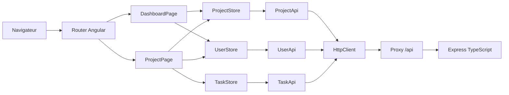
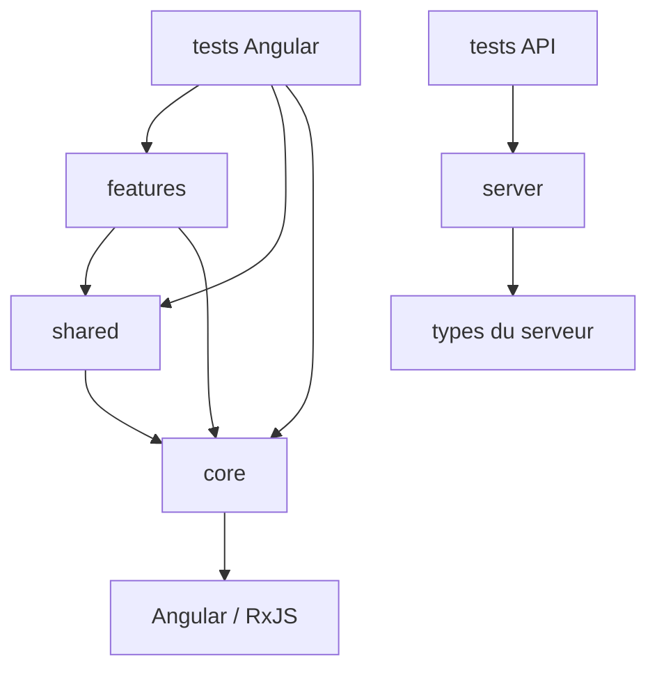

# Architecture

## Vue d’ensemble

L’application est une SPA standalone organized par responsabilité. Les routes chargent les features à la demande. Les services de `core` possèdent l’état et les accès HTTP. Les composants de `shared` ne connaissent pas la couche réseau.



## Arborescence

```text
src/app/
├── core/
│   ├── api/          # clients HTTP par ressource + token d’URL
│   ├── models/       # contrats TypeScript métier
│   ├── services/     # stores, notifications, préférences
│   └── utils/        # fonctions pures et normalisation d’erreurs
├── features/
│   ├── dashboard/    # vue portefeuille et laboratoire CD
│   ├── projects/     # espace projet et orchestration CRUD
│   └── not-found/    # route 404
├── shared/components/
│   ├── change-detection-lab/
│   ├── confirm-dialog/
│   ├── project-card/
│   ├── stat-card/
│   ├── task-editor-dialog/
│   ├── task-filter-bar/
│   └── task-table/
└── testing/          # données communes aux tests Angular
```

## Règles de dépendances



Règles appliquées :

- `core` ne dépend d’aucune feature ;
- `shared` ne dépend d’aucune feature ;
- une feature peut composer `core` et `shared` ;
- les API Angular ne connaissent que leur ressource ;
- les stores orchestrent les API et l’état ;
- les templates lisent des Signals, pas des身体 subscribe HTTP ;
- les fonctions de transformation restent pures et testables.

## State ownership

| État                          | Propriétaire                | Portée       | Raison                                                 |
| ----------------------------- | --------------------------- | ------------ | ------------------------------------------------------ |
| Projets et projet sélectionné | `ProjectStore`              | racine       | partagés entre dashboard et page projet                |
| Utilisateurs                  | `UserStore`                 | racine       | annuaire partagé par les cartes, tables et formulaires |
| Tâches du projet courant      | `TaskStore`                 | route projet | chaque navigation repart d’un espace isolé             |
| Préférence de densité         | `WorkspacePreferencesStore` | racine       | préférence transverse du shell                         |
| Notifications                 | `NotificationService`       | racine       | service d’infrastructure sans état métier              |
| Recherche et statut           | `ProjectPage`               | composant    | état local de la vue                                   |

## Dependency Injection

- `provideHttpClient()` installe l’infrastructure HTTP.
- `LAB_API_URL` fournit `/api` sans coder l’URL dans les clients.
- `ProjectStore` et `UserStore` utilisent `providedIn: 'root'`.
- `TaskStore` est déclaré dans `app.routes.ts` sur `projects/:projectId`.
- `WorkspacePreferencesStore` utilise `effect` uniquement pour synchroniser `localStorage`.

## États UI

Le type `LoadState` évite de confondre une absence de données et une panne :

```text
idle → loading → success
                ↘ empty
                ↘ error
```

- `idle` : aucun chargement demandé ;
- `loading` : requête active ;
- `success` : collection non vide ou ressource trouvée ;
- `empty` : réponse réussie sans élément ;
- `error` : échec HTTP, réseau ou parsing.

## API et proxy

Le navigateur appelle uniquement des chemins relatifs `/api`. En développement, `proxy.conf.json` transmet ces chemins à Express. Cette stratégie évite les URL absolues en production, les problèmes CORS pendant le développement et facilite le remplacement de backend.

## Limites assumées

- pas de persistance : un redémarrage de l’API réinitialise les données ;
- pas d’authentification ;
- pas de pagination ;
- pas de résolution de conflits optimiste ;
- pas de cache HTTP partagé ;
- pas de tests navigateur end-to-end.
