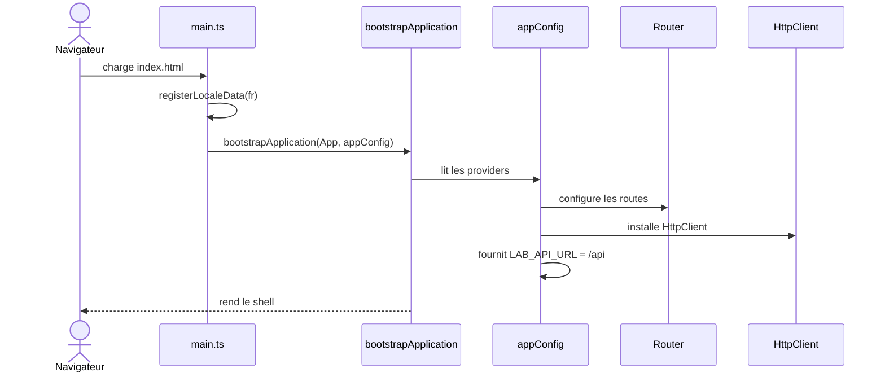
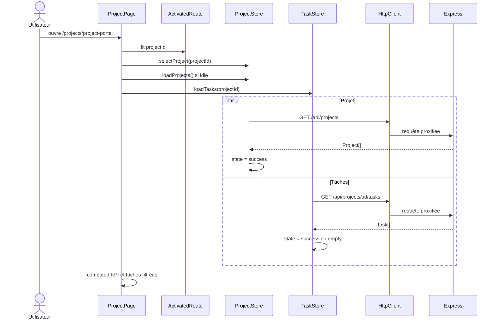
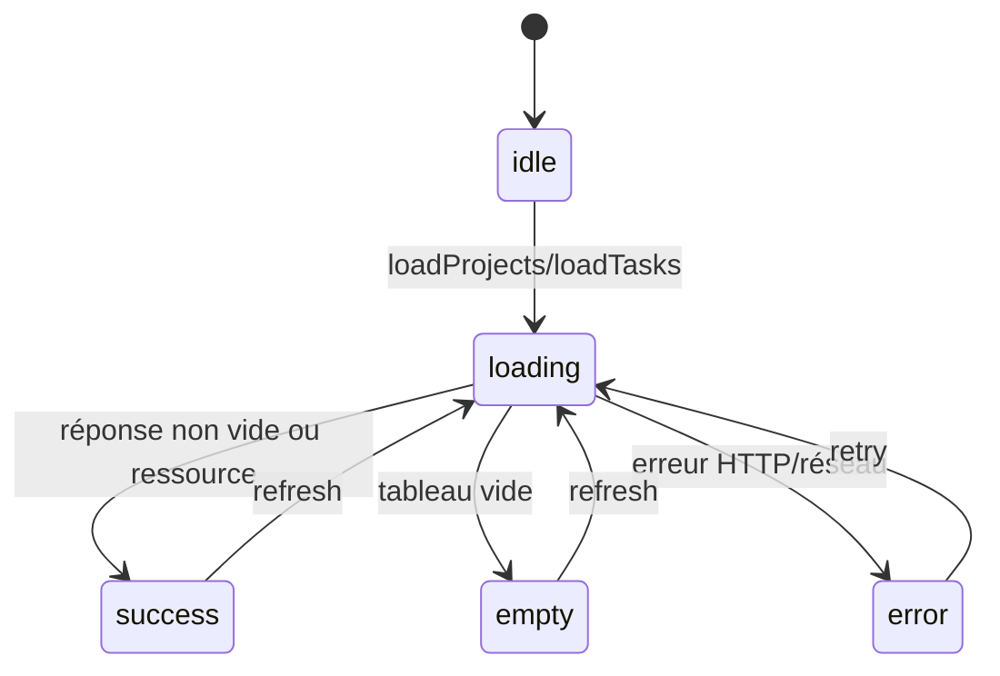
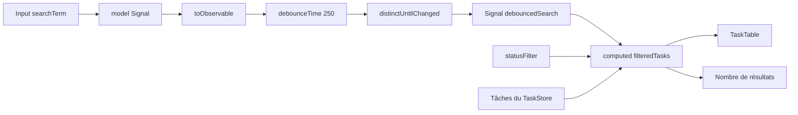
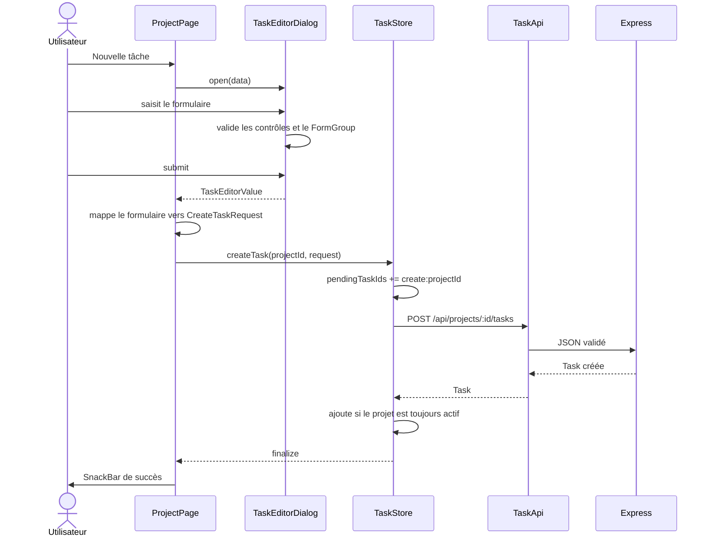
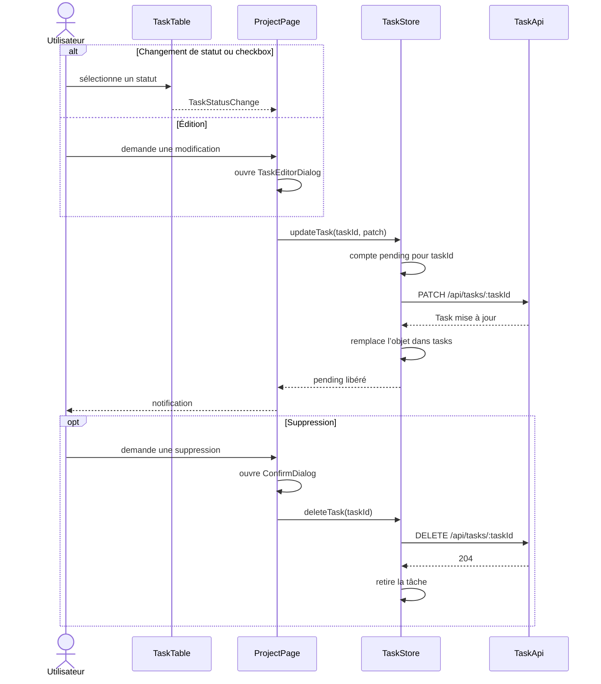
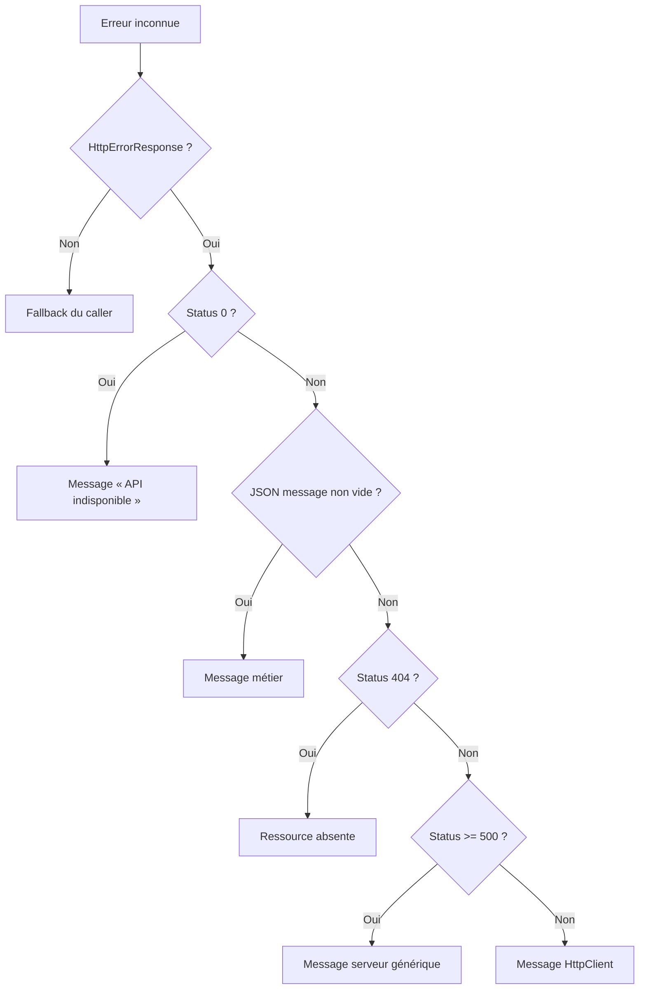
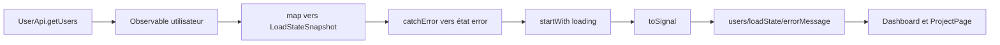
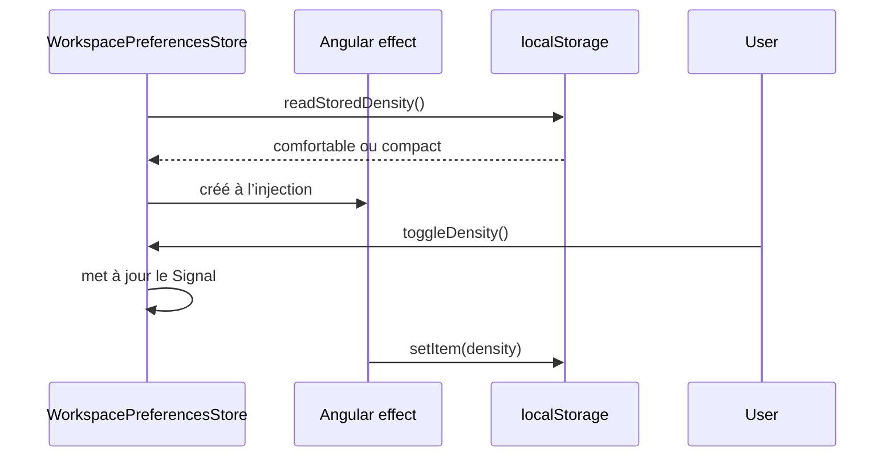

# Flux de données

## Bootstrap et injection

## Chargement d’une page projet

Les requêtes sont parallèles. `ProjectPage` attend un projet connu et un état terminal des tâches avant de présenter le contenu.

## États de chargement

`success` ne signifie pas « une requête est terminée » mais « une donnée exploitable est disponible ». `empty` est une réponse valide qui ne produit aucun element.

## Recherche

Le Signal de recherche est mis à jour à chaque frappe, mais le filtre coûteux n’est recalculé qu’après 250 ms sans nouvelle valeur.

## Création d’une tâche

Une réponse de création arrivée après navigation vers un autre projet est ignorée par `TaskStore`. Cela évite d’insérer la tâche dans la vue du nouveau projet.

## Mise à jour et suppression

Les mutations concurrentes sur une même tâche sont comptées. La première réponse ne retire pas prematurely le marqueur pending de la seconde.

## Normalisation d’erreur

## Conversion Observable vers Signal

## Préférences persistées

