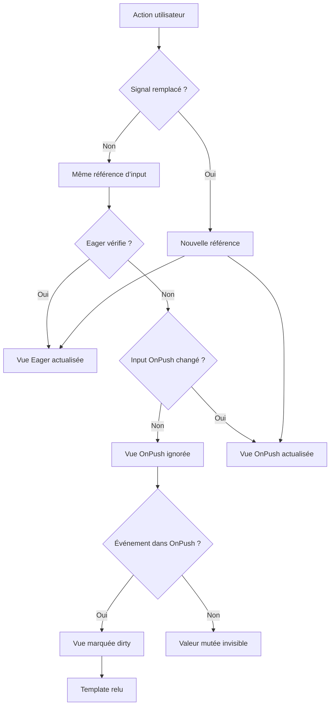

# Change Detection

## Contexte Angular 22

Angular 22 fonctionne sans Zone.js dans ce projet et utilise `OnPush` comme stratégie par défaut. Tous les composants applicatifs déclarent néanmoins `ChangeDetectionStrategy.OnPush` de façon explicite pour rendre leur intention visible.

Le laboratoire intègre une stratégie `ChangeDetectionStrategy.Eager`. Elle correspond à l’ancien `Default`, celui qui vérifie chaque composant atteint par le parcours de détection de changement ; `Default` est désormais déprécié et vaut `Eager`. Cette stratégie sert uniquement à rendre la différence observable.

## Trois notions à distinguer

### Référence d’une entrée

Angular compare l’identité d’une entrée. Si la même référence est fournie, un composant enfant `OnPush` n’est pas invalidé par ce changement.

### Signal

Par défaut, un Signal compare la nouvelle valeur à la précédente avec `Object.is`. Remplacer le Signal par un nouvel objet notifie donc ses lecteurs ; une mutation sur place ne produit pas de nouvelle identité au niveau du Signal.

### Événement utilisateur

Un clic déclaré dans un template marque la vue qui contient le handler comme dirty. Une vue `OnPush` déjà cochée est alors vérifiée même si son input n’a pas changé.

## Expérience 1 — mutation sur place

State initiale :

```ts
record = signal({ revision: 1, label: 'Objet A' });
```

Action :

```ts
record().label = 'Objet A muté';
```

Parent et rendu :

- le parent `OnPush` est invalidé parce que l’action vient de son template ou modifie un Signal lu par sa vue ;
- Eager vérifie ses champs même sans nouvelle référence ;
- OnPush reçoit exactement la même référence et peut conserver son affichage précédent.

Pour révéler la mutation déjà réalisée, l’utilisateur clique ensuite sur **+ Champ local** dans la sonde OnPush. Cet événement marque la sonde dirty ; elle vérifie alors le template et affiche la valeur mutée.

## Expérience 2 — remplacement de référence

```ts
record.update((current) => ({
  revision: current.revision + 1,
  label: `Objet B — révision ${current.revision + 1}`,
}));
```

Les deux strategies reçoivent une nouvelle identité d’input. Eager et OnPush se mettent à jour.

## Parcours d’observation

1. Ouvrir `/dashboard`.
2. Descendre jusqu’à **Change Detection Lab**.
3. Relier les deux premières valeurs `Objet A`.
4. Cliquer **Mutation sur place**.
5. Observer Eager immédiatement et OnPush avec retard.
6. Cliquer **+ Champ local** dans OnPush : la mutation devient visible.
7. Répéter avec **Nouvelle référence** : les deux sondes actualisent ensemble.

## Diagramme



## Règles appliquées dans l’application

- ne pas muter un objet d’état en place ;
- préférer `update`, `set` ou une nouvelle valeur ;
- utiliser un tableau ou une nouvelle référence après une opération ;
- exposer les tableaux en lecture seule dans les contrats ;
- conserver les components présentations sans effet de bord ;
- stocker les abonnements avec `takeUntilDestroyed` ;
- ne pas utiliser `ChangeDetectorRef.detectChanges()` comme solution générale ;
- ne pas faire confiance à `markForCheck()` pour réparer une mutationMm.

## Relation avec les Signals

Dans un template :

```html
<p>{{ user().name }}</p>
```

Le renderer lit le Signal. Une nouvelle valeur invalide précisément l Abel la dépendance. Une mutation interne du même objet ne change pas la valeur du Signal.

Pour un Signal qui contient un objet :

```ts
readonly user = signal({ name: 'Ada' });

updateName(name: string): void {
  this.user.update((user) => ({ ...user, name }));
}
```

## Relation avec RxJS

Un Observable peut notifier une vue sans être lu comme Signal. Dans ce projet, `toSignal` transforme le flux utilisateur en dépendance de template lisible. Pour la recherche inverse, `toObservable` expose un Signal à l’opérateur `debounceTime`.

## Tests du laboratoire

`change-detection-lab.spec.ts` vérifie :

1. la mutation sur place actualise Eager mais pas OnPush ;
2. un événement local révèle ensuite l’objet muté dans OnPush ;
3. une nouvelle référence actualise les deux stratégies.

## Erreurs frequent

- conclure qu’OnPush signifie « ne rend jamais » ;
- muter une propriété d’un objet reçu en input ;
- utiliser `ngOnPush` sans Signal ni état immutable ;
- appeler `detectChanges` après chaque callback HTTP ;
- oublier qu’un événement local peut vérifier une vue OnPush ;
- confondre changement de référence et changement de valeur de Signal.
