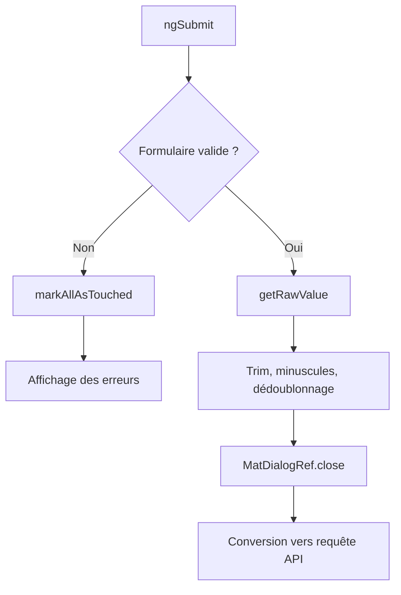

# Formulaires

## Choix : Reactive Forms

Le dialogue utilise les Reactive Forms et `FormBuilder` pour :

- disposer d’un modèle explicite ;
- typer les contrôles ;
- valider à la demande ;
- gérer des collections dynamiques ;
- tester les règles sans dépendre du DOM ;
- exposer un état `VALID` ou `INVALID` stable.

## `FormBuilder` et `FormGroup` : quel rôle pour chacun ?

`FormBuilder` ne remplace pas `FormGroup`. Il en est la fabrique recommandée par Angular :

- `FormBuilder.nonNullable.group(...)` construit le `FormGroup` racine ;
- `FormBuilder.nonNullable.control(...)` construit un contrôle scalaire ;
- `FormBuilder.array(...)` construit un `FormArray` ;
- le groupe retourné expose toujours les mêmes méthodes `value`, `status`, `valueChanges`, `getRawValue()` et `updateValueAndValidity()`.

Le projet utilise `FormBuilder` parce que le formulaire possède de nombreux contrôles imbriqués. La fabrique centralise `nonNullable`, les validateurs et les options, tout en donnant à TypeScript la structure exacte du groupe.

```ts
private readonly formBuilder = inject(FormBuilder);

protected readonly taskForm = this.formBuilder.nonNullable.group<TaskEditorControls>(
  {
    title: this.formBuilder.nonNullable.control('', {
      validators: [Validators.required],
    }),
    tags: this.formBuilder.array<FormControl<string>>([]),
  },
  { validators: [highPriorityRiskValidator] },
);
```

### Quand utiliser `FormGroup` ?

- un formulaire représente une entité ou un sous-ensemble de champs ;
- des champs dépendent les uns des autres ;
- il faut calculer ou afficher un statut global ;
- la soumission doit produire une valeur stable.

Dans cette application, `TaskEditorDialog.taskForm` est le `FormGroup` racine. La checklist utilise un sous-`FormGroup` par ligne parce qu’un libellé et un booléen constituent une unité de validation.

### Quand utiliser `FormControl` ?

Pour une valeur primitive autonome : titre, statut, date ou mitigation. Un `FormControl<string>` conserve le type du signal de formulaire, ce qui permet à `getRawValue()` de produire un objet exploitable sans conversion manuelle.

### Quand utiliser `FormArray` ?

Pour une collection dont la taille change : tags ou étapes de checklist. Un tableau JavaScript ne suffit pas, car Angular doit calculer la validité de chaque élément et signaler une suppression ou un ajout.

## API Angular utilisées : contexte, usage et raison

| API                               | Circonstance d’utilisation                          | Usage ici                        | Raison                                                                     |
| --------------------------------- | --------------------------------------------------- | -------------------------------- | -------------------------------------------------------------------------- |
| `inject(FormBuilder)`             | service disponible dans le contexte Angular courant | création des contrôles           | injection sans champ `Subscription` ni constructeur parasite               |
| `FormBuilder.nonNullable.group`   | formulaire composé de plusieurs contrôles           | modèle `TaskEditorControls`      | type complet, valeurs non nulles, validateurs centralisés                  |
| `FormBuilder.nonNullable.control` | champ scalaire                                      | titre, statut, mitigation        | conserve le type littéral ou `string`                                      |
| `FormBuilder.array`               | collection dynamique                                | tags et checklist                | ajout et suppression avec recalcul de validité                             |
| `ReactiveFormsModule`             | template piloté par le formulaire                   | import standalone du dialogue    | fournit `formGroup`, `formControlName`, `formArrayName` et `formGroupName` |
| `Validators.required`             | valeur réellement obligatoire                       | titre, responsable, échéance     | rejette `undefined`, `null` et chaîne vide                                 |
| `Validators.maxLength`            | limite stable du texte                              | titre et description             | bloque les valeurs excessives avant HTTP                                   |
| Validateur personnalisé           | invariant métier ou texte normalisé                 | mitigation, date, checklist      | couvre les règles que les validateurs standards ne connaissent pas         |
| `valueChanges`                    | observer chaque saisie                              | horodatage pédagogique           | journalise l’activité sans déclencher la requête API                       |
| `statusChanges`                   | réagir à `VALID`/`INVALID`                          | `formStatus`                     | évite de déduire la validité depuis chaque champ                           |
| `updateValueAndValidity`          | une valeur modifie une règle croisée                | changement de priorité           | recalcule le validateur du `FormGroup` complet                             |
| `takeUntilDestroyed()`            | abonnement créé dans le constructeur                | formulaires                      | fin automatique avec le dialogue                                           |
| `markAllAsTouched()`              | soumission invalide                                 | avant de conserver le dialogue   | affiche les erreurs de tous les contrôles                                  |
| `getRawValue()`                   | extraction après validation                         | avant normalisation              | renvoie la structure complète du groupe                                    |
| `MatDialogRef.close(value)`       | validation réussie                                  | sortie vers la page parente      | transmet une valeur métier, jamais le contrôle Angular                     |
| `signal`                          | valeur lue par le template                          | priorité et statut du formulaire | dépendance de lecture ciblée compatible avec OnPush                        |

## Comment le template est lié au modèle

```html
<form [formGroup]="taskForm" (ngSubmit)="submit()">
  <input formControlName="title" />

  <div formArrayName="tags">
    <input [formControlName]="index" />
  </div>

  <div formArrayName="checklist">
    <div [formGroupName]="index">
      <input formControlName="label" />
      <input type="checkbox" formControlName="done" />
    </div>
  </div>
</form>
```

- `[formGroup]` relie le `<form>` au `FormGroup` racine ;
- `formControlName` relie un élément à un contrôle de chemin connu ;
- `formArrayName` ouvre un `FormArray` et son espace de noms d’index ;
- `[formGroupName]="index"` ouvre le sous-groupe d’une ligne ;
- `(ngSubmit)` intercepte la soumission native du navigateur et appelle `submit()`, qui vérifie lui-même la validité du groupe.

## Architecture du formulaire

```text
TaskEditorControls
├── title: FormControl<string>
├── description: FormControl<string>
├── status: FormControl<TaskStatus>
├── priority: FormControl<TaskPriority>
├── assigneeId: FormControl<string>
├── dueDate: FormControl<string>
├── tags: FormArray<FormControl<string>>
├── checklist: FormArray<FormGroup<ChecklistItemControls>>
└── riskMitigation: FormControl<string>
```

## Contrôles non nullables

```ts
title: this.formBuilder.nonNullable.control(this.data.task?.title ?? '', {
  validators: [Validators.required, trimmedMinimumLength(3), nonBlank],
});
```

`nonNullable` évite que les valeurs absentes soient transformées en `null`. `getRawValue()` retourne ainsi le type annoncé sans obligation de normaliser chaque champ avant l’envoi.

## Validation

| Contrôle              | Règles                                                       |
| --------------------- | ------------------------------------------------------------ |
| titre                 | requis, 3 à 100 caractères, non composé uniquement d’espaces |
| description           | maximum 500 caractères                                       |
| responsable           | obligatoire                                                  |
| échéance              | obligatoire et calendaire au format `YYYY-MM-DD`             |
| checklist             | au moins un item, libellé de 2 caractères minimum            |
| priorité + mitigation | si priorité haute, mitigation non vide                       |

La mitigation est une règle du `FormGroup` :

```ts
if (priority === 'high' && !riskMitigation.trim()) {
  return { riskMitigationRequired: true };
}
```

## FormArray

Les tags et la checklist sont des `FormArray` :

```ts
tags: this.formBuilder.array<FormControl<string>>(
  initialTags.map((tag) => this.formBuilder.nonNullable.control(tag)),
);
```

Ajouter une entrée :

```ts
this.tagControls.push(this.formBuilder.nonNullable.control(''));
```

Retirer une entrée :

```ts
this.tagControls.removeAt(index);
```

Le template utilise `formArrayName` et `[formControlName]="index"`.

## Normalisation à la soumission

Avant de fermer le dialogue :

- chaque tag est trimé ;
- les tags sont convertis en minuscules ;
- les doublons sont supprimés avec `Set` ;
- les libellés de checklist sont trimés ;
- la mitigation est trimée.

Cette normalisation est visible dans `TaskEditorValue`. La page parente la convertit ensuite en `CreateTaskRequest` ou `UpdateTaskRequest`.

## Défense en profondeur

Le frontend fournit des messages immédiats, mais Express valide également :

- les longueurs ;
- les unions `TaskStatus` et `TaskPriority` ;
- le responsable ;
- le format de la date ;
- les tableaux de tags ;
- la structure de la checklist ;
- la mitigation obligatoire pour une priorité haute.

Un client qui contourne Angular reçoit donc un `400` explicite et ne peut pas enregistrer une entité invalide.

## États du formulaire

Le dialogue observe :

- `valueChanges` pour le dernier changement ;
- `statusChanges` pour `VALID`, `INVALID`, `PENDING` ou `DISABLED` ;
- `dirty` et `touched` pour l’état Angular ;
- la priorité dans un Signal pour afficher conditionnellement la mitigation.

```ts
this.taskForm.valueChanges
  .pipe(takeUntilDestroyed())
  .subscribe(() => this.formStatus.set(this.taskForm.status));
```

## Soumission



Si le formulaire est invalide, aucun dialogue ne se ferme. L’utilisateur conserve ses données et peut corriger les contrôles.

## Dialogues

- `TaskEditorDialog` utilise `MAT_DIALOG_DATA` et `MatDialogRef` ;
- `ConfirmDialog` retourne un `boolean` ;
- une annulation retourne `undefined` et ne déclenche aucune mutation.

## Tests

Le fichier de test du dialogue couvre :

- le préremplissage ;
- l’état initial invalide d’une création ;
- le rejet d’un titre composé d’espaces ;
- le rejet d’une date calendaire inexistante ;
- la normalisation des tags ;
- la conservation de la mitigation ;
- l’annulation ;
- les validateurs isolés.

## Extensions

- afficher une erreur de serveur près du champ concerné ;
- synchroniser les dates avec un sélecteur Material ;
- ajouter un message de confirmation après sauvegarde ;
- créer un validateur composé pour la durée maximale ;
- persister un brouillon sans hydrater le signal source.
