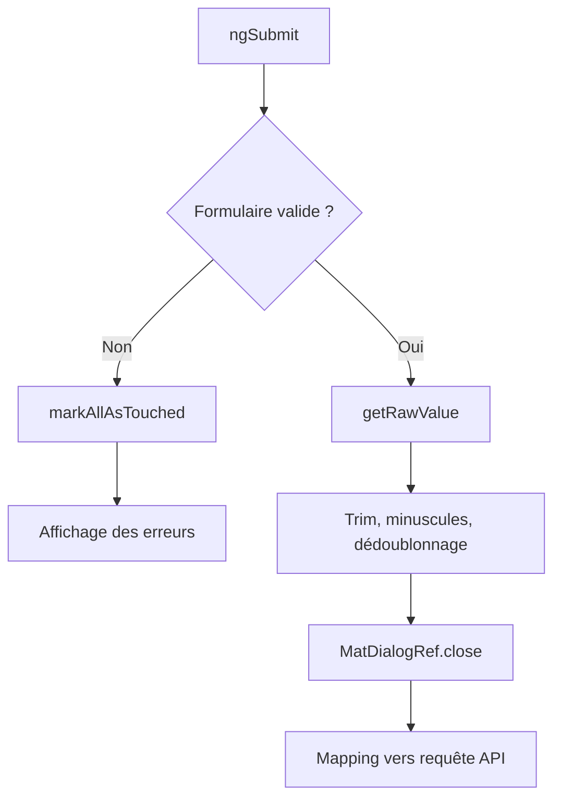

# Formulaires

## Choix : Reactive Forms

Le dialogue utilise les Reactive Forms pour :

- disposer d’un modèle explicite ;
- typer les contrôles ;
- valider à la demande ;
- gérer des collections dynamiques ;
- tester les règles sans dépendre du DOM ;
- exposer un état `VALID` ou `INVALID` stable.

## Architecture du formulaire

```text
TaskEditorControls
├── title: FormControl<string>
├── description: FormControl<string>
├── status: FormControl<TaskStatus>
├── priority: FormControl<TaskPriority>
├── assigneeId: FormControl<string>
├── dueDate: FormControl<string>
├── tags: FormArray<FormControl<string>>
├── checklist: FormArray<FormGroup<ChecklistItemControls>>
└── riskMitigation: FormControl<string>
```

## Contrôles non nullables

```ts
title: new FormControl(this.data.task?.title ?? '', {
  nonNullable: true,
  validators: [Validators.required, Validators.minLength(3), nonBlank],
});
```

`nonNullable` évite que les valeurs absences soient transformées en `null`. `getRawValue()` retourne ainsi le type annoncé sans obligation de normaliser chaque champ avant l’envoi.

## Validation

| Contrôle              | Règles                                                       |
| --------------------- | ------------------------------------------------------------ |
| titre                 | requis, 3 à 100 caractères, non composé uniquement d’espaces |
| description           | maximum 500 caractères                                       |
| responsable           | obligatoire                                                  |
| échéance              | obligatoire                                                  |
| checklist             | au moins un item, libellé de 2 caractères minimum            |
| priorité + mitigation | si priorité haute, mitigation non vide                       |

La mitigation est une règle du `FormGroup` :

```ts
if (priority === 'high' && !riskMitigation.trim()) {
  return { riskMitigationRequired: true };
}
```

## FormArray

Les tags et la checklist sont des `FormArray` :

```ts
readonly tags = new FormArray(
  initialTags.map((tag) => new FormControl(tag, { nonNullable: true })),
);
```

Ajouter une entrée :

```ts
this.tagControls.push(new FormControl('', { nonNullable: true }));
```

Retirer une entrée :

```ts
this.tagControls.removeAt(index);
```

Le template utilise `formArrayName` et `[formControlName]="index"`.

## Normalisation à la soumission

Avant de fermer le dialogue :

- chaque tag est trimé ;
- les tags sont convertis en minuscules ;
- les doublons sont supprimés avec `Set` ;
- les libellés de checklist sont trimés ;
- la mitigation est trimée.

Cette normalisation est visible dans `TaskEditorValue`. La feature la convertit ensuite en `CreateTaskRequest` ou `UpdateTaskRequest`.

## Défense en profondeur

Le frontend fournit des messages immédiats, mais Express valide également :

- les longueurs ;
- les unions `TaskStatus` et `TaskPriority` ;
- le responsable ;
- le format de la date ;
- les tableaux de tags ;
- la structure de la checklist ;
- la mitigation obligatoire pour une priorité haute.

Un client qui contourne Angular ne peut donc pas enregistrer une entité invalide.

## États du formulaire

Le dialogue observe :

- `valueChanges` pour le dernier changement ;
- `statusChanges` pour `VALID`, `INVALID`, `PENDING` ou `DISABLED` ;
- `dirty` et `touched` pour l’état Angular ;
- la priorité dans un Signal pour afficher conditionnellement la mitigation.

```ts
this.taskForm.valueChanges
  .pipe(takeUntilDestroyed())
  .subscribe(() => this.formStatus.set(this.taskForm.status));
```

## Soumission



Si le formulaire est invalide, aucun dialogue ne se ferme. L’utilisateur conserve ses données et peut corriger les contrôles.

## Dialogues

- `TaskEditorDialog` utilise `MAT_DIALOG_DATA` et `MatDialogRef` ;
- `ConfirmDialog` retourne un `boolean` ;
- une annulation retourne `undefined` et ne déclenche aucune mutation.

## Tests

Le spec du dialogue couvre :

- le préremplissage ;
- l’état initial invalide d’une création ;
- le rejet d’un titre composé d’espaces ;
- la normalisation des tags ;
- la conservation de la mitigation ;
- l’annulation ;
- les validateurs isolés.

## Extensions

- afficher une erreur de serveur près du champ concerné ;
- synchroniser les dates avec un picker Material ;
- ajouter un message de confirmation après sauvegarde ;
- créer un Validators composed pour la durée maximale ;
- persister un brouillon sanshydrater le signal source.
