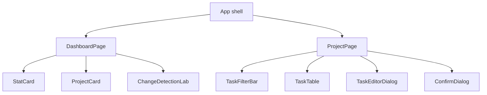

# Composants

## Principes

Les components applicatifs sont standalone, `OnPush` et déclarent leurs imports. Les composants partagés sont présentations ou pedagogical labs ; ils ne déclenchent pas directement HTTP.

## Arborescence des responsabilités



## App

`src/app/app.ts` fournit :

- le Material Toolbar ;
- la navigation principale ;
- un menu secondaire ;
- le `RouterOutlet` ;
- la préférence de densité globale.

Il ne contient aucune logique de données métier.

## DashboardPage

Responsabilités :

- charger les projets au premier rendu ;
- exposer les compteurs de `ProjectStore` ;
- afficher les états de chargement, erreur et vide ;
- naviguer vers un projet ;
- héberger le laboratoire Change Detection.

La page ne connaît pas la forme des URLs : elle appelle `ProjectStore`, qui appelle `ProjectApi`.

## ProjectPage

Responsabilités :

- lire `projectId` ;
- charger projet, utilisateurs et tâches ;
- composer les KPI ;
- débouncer la recherche ;
- ouvrir les dialogues ;
- convertir le formulaire en requête ;
- notifier le résultat.

Les détails HTTP restent dans `TaskStore` et `TaskApi`.

## StatCard

Entrées :

- `label` ;
- `value` ;
- `icon` ;
- `hint` ;
- `tone`.

La valeur numérique est formatée par `Intl.NumberFormat('fr-FR')`. Le component ne possède aucun état.

## ProjectCard

Entrées :

- `project` ;
- `users`.

Sortie :

- `projectSelected`.

Le nom du propriétaire est dérivé par `computed`. Si l’utilisateur n’existe plus, l’interface affiche « Non assigné ».

## TaskFilterBar

Modèles :

- `searchTerm` ;
- `statusFilter`.

Entrée :

- `resultCount`.

Sortie :

- `filtersCleared`.

Le parent peut écrire les modèles avec :

```html
<app-task-filter-bar
  [(searchTerm)]="searchTerm"
  [(statusFilter)]="statusFilter"
  [resultCount]="filteredTasks().length"
/>
```

## TaskTable

Entrées :

- `tasks` ;
- `users` ;
- `pendingTaskIds`.

Sorties :

- `refreshRequested` ;
- `taskStatusChanged` ;
- `taskEditRequested` ;
- `taskDeleteRequested`.

La table calcule le nom du responsable et la progression de la checklist. Elle ne modifie pas la tâche.

## TaskEditorDialog

Entrée :

- `MAT_DIALOG_DATA` avec projet, utilisateurs et tâche optionnelle.

Sortie :

- `TaskEditorValue` par `MatDialogRef.close`.

Il encapsule le formulaire, la validation et la normalisation. Il ne déclenche pas HTTP.

## ConfirmDialog

Affiche un titre, un message et un libellé de confirmation. Retourne `true` ou `false`.

## ChangeDetectionLab

Contient deux sondes :

- `EagerProbe` pour le comportement Always Check ;
- `OnPushProbe` pour la stratégie par défaut Angular 22.

Il est volontairement pédagogique et ne doit pas être copié dans une feature métier.

## Material Table

`TaskTable` utilise `MatTableModule` avec des colonnes déclarées. La source `[dataSource]="taskRows()"` est une copie computed du tableau reçu, sans tri ni mutation de l’input.

## Accessibilité

- les icon buttons possèdent un `aria-label` ;
- les filtres sont regroupés dans une région `aria-label` ;
- les formulaires utilisent `mat-label` ;
- les zones de chargement utilisent `aria-live` ;
- la checkbox décrit la tâche concernée ;
- la navigation possède un label principal ;
- la route 404 propose un lien explicite.

## Tests de components

Chaque component métier possède un spec voisin. Les tests utilisent :

- `fixture.componentRef.setInput` pour les inputs ;
- les outputs pour observer les événements ;
- `TestBed` pour la DI ;
- `HttpTestingController` lorsqu’un client est nécessaire ;
- les données de `src/app/testing/test-data.ts` pour éviter des fixtures divergentes.
